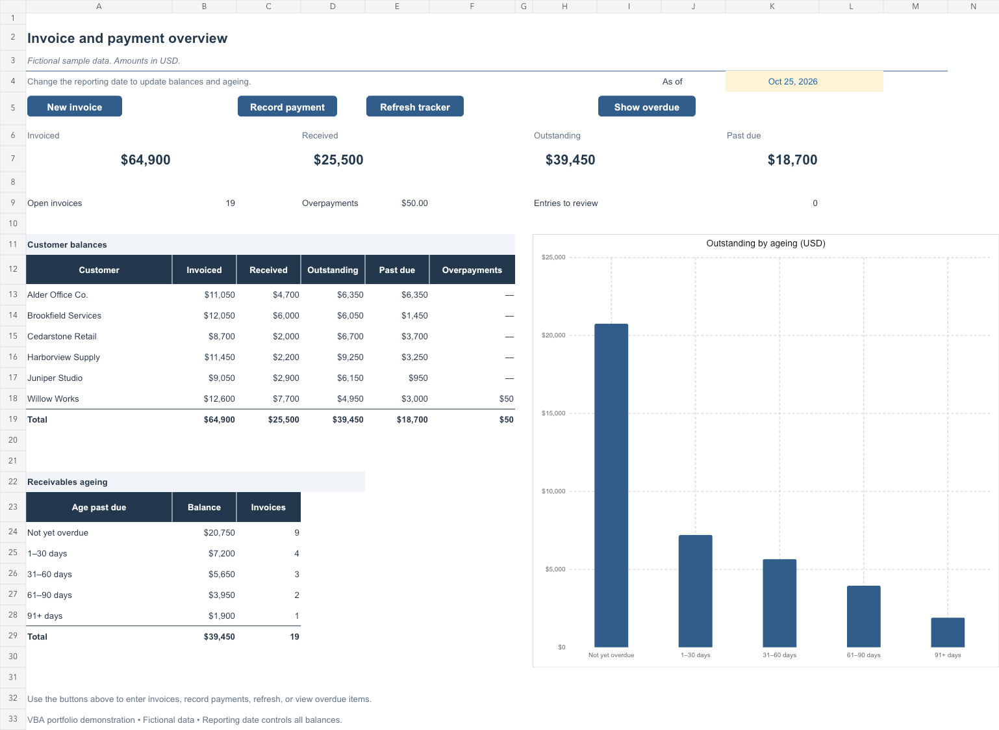

# Invoice & Payment Tracker

**An Excel/VBA receivables project by Charlotte Hummel.**

Validated entry forms connect invoices, payments, outstanding balances, and aging reports in one workbook. This repository includes the working `.xlsm`, readable VBA modules, a browser demo, and a reproducible walkthrough using fictional data.



**[Try the live demo](https://charlottehummel2026-gif.github.io/invoice-payment-tracker-vba/)** | **[Download the Excel workbook](downloads/invoice-payment-tracker.xlsm)** | **[VBA source](src/vba/ModTracker.bas)** | **[Demo walkthrough](docs/DEMO.md)**

[View the interactive preview screenshot](assets/browser-demo.png).

## The business problem

Invoice and receipt records are easy to fragment across separate files. Manual entry can leave inconsistent IDs, unmatched payments, and unclear outstanding balances. This project provides a repeatable entry workflow and a reporting date that keeps the dashboard tied to the underlying records.

## Try the project

- **Browser:** visit the [live demo](https://charlottehummel2026-gif.github.io/invoice-payment-tracker-vba/), choose **Start guided demo**, and follow a $1,200 invoice through a $400 partial payment to its $800 overdue balance. The preview runs entirely in the browser and resets to the original fictional data. You can also open `index.html` locally.
- **Excel:** download `downloads/invoice-payment-tracker.xlsm` and open it in desktop Excel. Review the included VBA and enable macros for this workbook to use its buttons. The cover's **Open tracker** button opens the dashboard.
- **Repository:** [charlottehummel2026-gif/invoice-payment-tracker-vba](https://github.com/charlottehummel2026-gif/invoice-payment-tracker-vba). See the [publishing guide](docs/PUBLISHING.md) to maintain or republish the site.

The browser preview recreates the workflow in JavaScript; it does not execute VBA or modify the Excel download. The workbook is the VBA implementation.

## What it demonstrates

| Capability | Implementation |
| --- | --- |
| Consistent entry | Required-field, date, amount, and invoice-match checks before a save |
| Unique identifiers | Sequential invoice IDs by year and payment IDs |
| Payment allocation | Receipts matched to invoices; partial payments and overpayments handled separately |
| Maintainable data | Excel `ListObject` tables with automatic row expansion |
| Calculated reporting | Formula-driven customer balances, overdue amounts, and aging chart |
| Operational controls | Macro buttons for entry, save, clear, navigation, filtering, and refresh |
| Recovery | Refresh restores calculated columns; handled errors restore Excel event state |

## Workbook structure

| Sheet | Purpose |
| --- | --- |
| Cover | Branded opening page and dashboard navigation |
| Overview | Reporting date, headline balances, customer summary, and aging chart |
| Invoices | Invoice register, ownership, follow-up, status, and entry checks |
| Payments | Receipts matched to invoice IDs, with references and entry checks |
| Entry | Separate invoice and payment forms with VBA save buttons |

The sample includes **25 fictional invoices and 15 receipts**. As of **October 25, 2026**, it reports $64,900 invoiced, $25,500 received, $39,450 outstanding, $18,700 past due, and $50 in overpayments. The cover is an illustration; its printed figures are not live dashboard values.

## Review the code

- [`ModTracker.bas`](src/vba/ModTracker.bas): form validation, IDs, row allocation, entry, navigation, and filters.
- [`ModFormulas.bas`](src/vba/ModFormulas.bas): restores calculated columns and date/currency formats.
- [`ThisWorkbook.cls`](src/vba/ThisWorkbook.cls): opens on the cover. This is a reference export of the workbook document module; do not import it as a separate class to replace the open event.
- [`tracker-engine.js`](assets/tracker-engine.js): financial rules for the browser preview, using integer cents.

The `.xlsm` already contains the VBA. No source import is needed to try it. [Architecture notes](docs/ARCHITECTURE.md) describe the flow and design choices.

## Validation

Run the dependency-free browser-rule tests with Node.js 20 or later:

```sh
npm test
```

An optional offline VBA smoke test uses `pyopenvba==6.5.0`:

```sh
python -m pip install pyopenvba==6.5.0
python tests/workbook_smoke.py
```

Offline interpretation is separate from Microsoft Excel execution. See [test coverage and the native Excel checklist](docs/TESTING.md) for the verification boundary. No time savings, production use, or operational impact measurements are claimed.

## Repository contents

```text
index.html                 Portfolio and interactive browser demo
assets/                    Styling, demo logic/data, cover, workbook previews
downloads/                 Macro-enabled workbook and checksum manifest
src/vba/                   VBA source extracted from the download
docs/                      Architecture, walkthrough, testing, publishing
tests/                     Browser-rule tests and offline VBA smoke test
```

For a resume, a concise project description is: **"Developed an Excel/VBA receivables tracker with validated entry forms, automatic IDs, payment allocation, aging analysis, and dashboard reporting."** Link the published demo and repository beside the project title.
