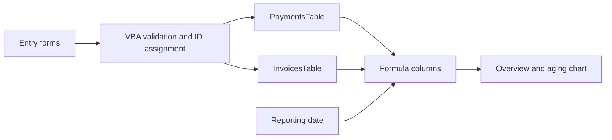

# Architecture

The Excel workbook is the main automation artifact. A separate static website lets a reviewer explore the workflow without installing Excel.

## Excel data flow

`InvoicesTable` stores each invoice once. `PaymentsTable` stores each receipt separately and references an invoice ID. Formula columns derive received amounts, outstanding balances, overpayments, days late, and status. Reporting includes only invoices issued and receipts received by the selected reporting date.

## VBA responsibilities

`ModTracker` uses ordinary Excel worksheet, range, and table objects. It validates input before allocating a row, generates the next ID, writes typed values, calls formula restoration, and recalculates the payment, invoice, and overview sheets. A failed save keeps the form available; handled write failures clear the partially written input cells and restore the previous `Application.EnableEvents` state.

`ModFormulas` restores the calculated columns from explicit formula definitions. `ThisWorkbook.Workbook_Open` activates the Cover sheet. Native shapes have macro assignments for navigation and actions.

The code does not use Windows-only COM automation, contact outside services, send payments, or change Excel's macro-security settings. Native execution on a particular Excel version still needs the checklist in `TESTING.md`.

## Browser preview

The site has no build step, backend, external fonts, analytics, or runtime libraries. `demo-data.js` contains the fictional workbook inputs; `tracker-engine.js` implements the preview's validation and calculations; `app.js` handles forms, rendering, filtering, and the guided example.

Amounts are stored in integer cents. Dates use ISO date strings and UTC day comparisons. Changes remain in memory for the current tab and never modify the workbook. User-supplied text is escaped before it enters generated HTML.

## Scope and tradeoffs

- Customer and owner dropdowns use a fixed demonstration list.
- All amounts are USD and include any applicable tax; this is not a tax engine or full accounting system.
- Overpayments are shown separately; refunds and credit-note posting are outside this demonstration.
- The preview does not attempt to execute or emulate arbitrary VBA.
- The downloaded workbook is a portfolio snapshot. Later edits in a user's working workbook will not synchronize to the website.
